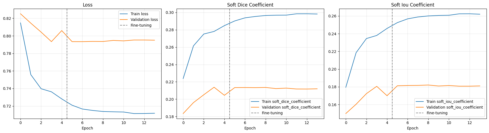
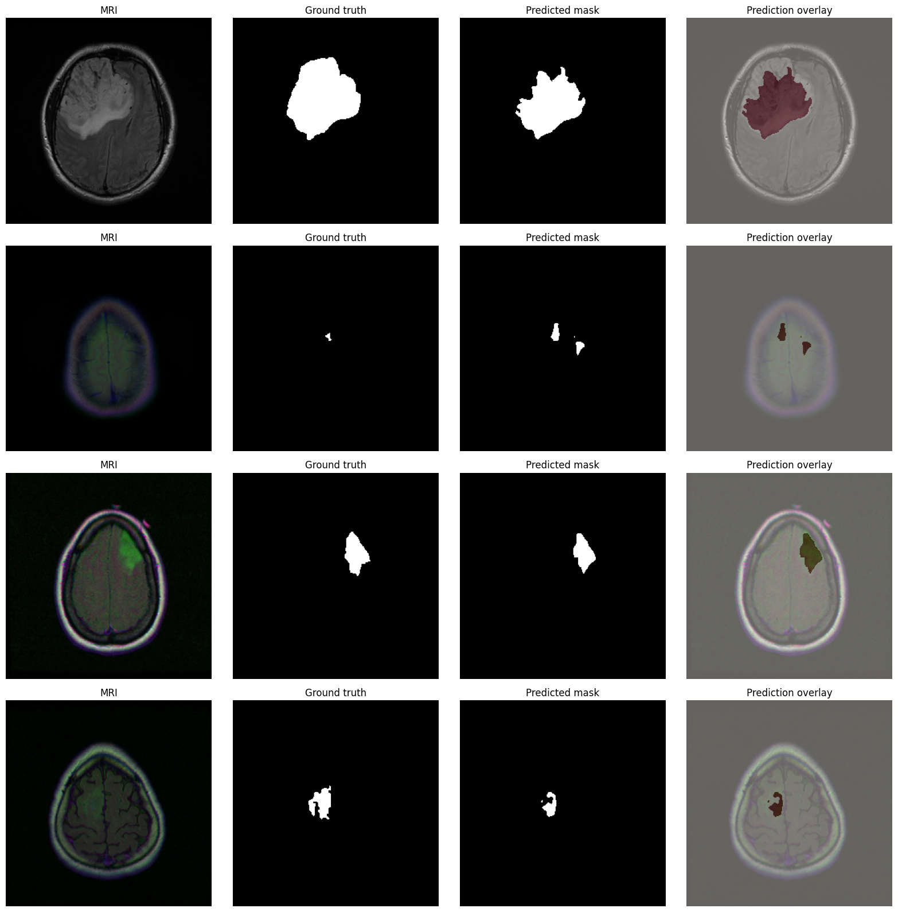

# Brain MRI Tumor Segmentation with DeepLabV3+

[](https://colab.research.google.com/github/BensuVarol/brain-mri-tumor-segmentation-deeplabv3plus/blob/main/notebooks/Brain_MRI_Tumor_Segmentation_DeepLabV3Plus_V2.ipynb)

Brain tumor segmentation on 2D MRI slices using DeepLabV3+ with an ImageNet-pretrained MobileNetV2 encoder. The latest supplied, executed notebook records **test Global Dice 0.8359** and **test Global IoU 0.7181** on **378 slices from 11 held-out patients**, using a **validation-selected threshold of 0.70**.

[Executed notebook](notebooks/Brain_MRI_Tumor_Segmentation_DeepLabV3Plus_V2.ipynb) · [Recorded results and provenance](results/README.md) · [Recorded run summary](results/recorded_run_summary.json)

## Dataset and patient-level split

The notebook downloads the [LGG MRI Segmentation dataset](https://www.kaggle.com/datasets/mateuszbuda/lgg-mri-segmentation) using KaggleHub (`mateuszbuda/lgg-mri-segmentation`). The recorded dataset contains **110 patients and 3,929 image-mask pairs**: **1,373 tumor-positive** and **2,556 tumor-free** slices. Raw MRI images and masks are not stored in this repository.

| Split | Patients | MRI slices | Tumor-positive slices | Tumor-free slices |
|---|---:|---:|---:|---:|
| Training | 88 | 3,165 | 1,137 | 2,028 |
| Validation | 11 | 386 | 109 | 277 |
| Test | 11 | 378 | 127 | 251 |
| Total | **110** | **3,929** | **1,373** | **2,556** |

The patient-level split uses seed **42** and stratifies by whether a patient has a tumor-positive mask. All slices from a patient remain in one subset. The supplied notebook records successful assertions that training, validation, and test patient IDs are disjoint. See [the recorded split summary](results/dataset_split_summary.csv).

## Model and training

- **Input:** 256 × 256 RGB MRI slices, mapped to **[-1, 1]** for MobileNetV2. Masks use nearest-neighbor resizing and are binarized.
- **Augmentation:** paired horizontal flips plus image brightness/contrast changes, applied only to training data.
- **Architecture:** ImageNet-pretrained MobileNetV2 encoder, atrous spatial pyramid pooling (ASPP), a DeepLabV3+ decoder, and a one-channel sigmoid output.
- **Loss:** binary cross-entropy + per-image soft Dice loss.
- **Optimization:** Adam, batch size **8**; decoder warm-up at **1e-3**, followed by partial encoder fine-tuning at **1e-5** with learning-rate reduction.
- **Checkpoint selection:** lowest validation loss, compared across the warm-up and fine-tuning stages.
- **Recorded training:** **5 warm-up epochs + 9 fine-tuning epochs = 14 completed epochs**. The configured maximum was 25 epochs; early stopping ended the run at epoch 14.
- **Selected checkpoint:** fine-tuning stage, **epoch 7** according to the saved early-stopping log.
- **Threshold selection:** validation Global Dice over **0.10–0.90 in steps of 0.10**, with empty-slice false-positive rate as a secondary criterion. The selected threshold is **0.70**.

The notebook also verifies metric formulas, batch aggregation, empty-mask behavior, and model saving/reloading. On the recorded single validation reload sample, the maximum absolute prediction difference was **0.0**. See [the saved verification messages](results/recorded_verification_checks.txt) and [training log](results/training_log.txt).

## Recorded validation and test results

Values below are rounded to four decimal places from the saved notebook outputs. Both subsets use the selected checkpoint and threshold **0.70**.

| Metric | Validation: 386 slices / 11 patients | Test: 378 slices / 11 patients |
|---|---:|---:|
| Global Dice | **0.8193** | **0.8359** |
| Global IoU | **0.6939** | **0.7181** |
| Mean Dice, all slices | 0.8408 | 0.7601 |
| Mean IoU, all slices | 0.8111 | 0.7275 |
| Mean Dice, tumor-positive slices | 0.7572 | 0.7663 |
| Mean IoU, tumor-positive slices | 0.6520 | 0.6692 |
| Precision | 0.8162 | 0.8683 |
| Recall / sensitivity | 0.8224 | 0.8059 |
| Specificity | 0.9991 | 0.9985 |
| Pixel accuracy | 0.9982 | 0.9961 |
| Empty-slice false-positive rate | 0.1264 (35 / 277) | 0.2430 (61 / 251) |

[Recorded validation table](results/recorded_validation_metrics.csv) · [Recorded test table](results/recorded_test_metrics.csv) · [Displayed validation threshold search](results/validation_threshold_table.txt)

**Global Dice** pools true-positive, false-positive, and false-negative pixels across the subset: `2TP / (2TP + FP + FN)`. **Global IoU** is `TP / (TP + FP + FN)`. Mean image metrics give each MRI slice equal weight. Tumor-positive metrics include only slices with nonempty reference masks. The empty-slice false-positive rate is the fraction of reference-empty slices containing **any predicted positive pixel**; it is not a patient-level diagnosis rate.

Thresholded Dice/IoU are **1** when both reference and prediction are empty, and **0** when exactly one is empty. Training Soft Dice/IoU instead use probability values and smoothing, including on empty masks; their curves are not interchangeable with the binary Global Dice/IoU table. Pixel accuracy is reported alongside overlap and error metrics because background pixels dominate.

The checkpoint and threshold are selected on validation data before test predictions are collected in the recorded execution. Test reference masks are available here, so these are labeled internal test measurements. Evaluation is slice-level or pixel-pooled at 256 × 256, not patient-wise or 3D volume-level.

## Comparison with the prior recorded V2 run

The previous notebook is retained in [Git history](https://github.com/BensuVarol/brain-mri-tumor-segmentation-deeplabv3plus/blob/a73826435449aa171335b03538d9d528c56ee0b6/notebooks/Brain_MRI_Tumor_Segmentation_DeepLabV3Plus_V2.ipynb). Both runs use the same split code and seed and report the same subset sizes. The architecture, loss, preprocessing, augmentation, and training-stage code are unchanged.

| Test measure | Prior recorded V2 | Latest supplied Final |
|---|---:|---:|
| Global Dice | 0.8283 | **0.8359** |
| Global IoU | 0.7069 | **0.7181** |
| Mean Dice, all slices | 0.6268 | **0.7601** |
| Mean Dice, tumor-positive slices | **0.7948** | 0.7663 |
| Recall / sensitivity | **0.8205** | 0.8059 |
| Empty-slice false-positive rate, lower is better | 0.4582 | **0.2430** |
| Validation-selected threshold | 0.80 | 0.70 |

The latest recorded run has slightly higher pooled test overlap and fewer false-positive empty slices, while positive-slice Mean Dice and recall are lower. It is not an improvement on every metric. These are separate training runs using TensorFlow **2.20.0** and **2.21.0** respectively; the differences cannot be attributed solely to the added code checks.

## Recorded figures

The figures below were extracted directly from the supplied notebook's saved PNG outputs. Their extraction locations and hashes are documented in [the results notes](results/README.md).

### Training curves

The dashed line separates warm-up and fine-tuning. The run completed 14 epochs.



### Test prediction examples

The notebook selects four tumor-positive test slices using its fixed seed. Columns show the MRI, reference mask, binary prediction at **0.70**, and prediction overlay. These examples do not show tumor-free false-positive cases; those are quantified in the results table above.



## How to run

1. Open [the notebook in Colab](https://colab.research.google.com/github/BensuVarol/brain-mri-tumor-segmentation-deeplabv3plus/blob/main/notebooks/Brain_MRI_Tumor_Segmentation_DeepLabV3Plus_V2.ipynb) and select a GPU runtime.
2. Run the cells from top to bottom. KaggleHub downloads the dataset automatically.
3. Review the split checks, warm-up/fine-tuning logs, selected validation threshold, and test results.
4. Save the trained `.keras` model and required runtime outputs before ending the temporary Colab session.

For a local environment, install [requirements.txt](requirements.txt) before opening the notebook. Exact results may vary with runtime and dependency versions.

The repository notebook is a **byte-for-byte copy** of the supplied `Brain_MRI_Tumor_Segmentation_DeepLabV3Plus_Final (1).ipynb`. Its existing `V2.ipynb` repository filename is retained to preserve GitHub and Colab links. All **24 code cells** have execution counts and no recorded error outputs. This repository update did **not** rerun training or inference.

The committed CSV/JSON records are transcribed from rounded notebook displays, rather than copied from the unavailable original full-precision runtime files. The supplied notebook does not embed the trained `.keras` file or all test masks. Those artifacts, raw dataset files, credentials, and run archives are excluded.

## Limitations

- A single recorded run and one patient-level split are reported; no repeated-seed uncertainty interval or external validation is supplied.
- Test data include only **11 patients**, despite containing 378 correlated MRI slices.
- Global pixel-pooled scores and slice-average scores describe different aspects of performance; neither is a patient-wise or 3D-volume score.
- **61 of 251 tumor-free test slices** contain at least one false-positive predicted pixel.
- The latest run's positive-slice Mean Dice and recall are lower than the prior recorded run.
- The workflow uses 2D MRI slices and has not been externally clinically validated. It is intended for research and education.

## Repository structure

```text
brain-mri-tumor-segmentation-deeplabv3plus/
├── notebooks/
│   └── Brain_MRI_Tumor_Segmentation_DeepLabV3Plus_V2.ipynb
├── data/
│   └── README.md
├── results/
│   ├── README.md
│   ├── input_example.png
│   ├── training_curves.png
│   ├── prediction_results.png
│   ├── dataset_split_summary.csv
│   ├── recorded_validation_metrics.csv
│   ├── recorded_test_metrics.csv
│   ├── validation_threshold_table.txt
│   ├── training_log.txt
│   ├── recorded_verification_checks.txt
│   └── recorded_run_summary.json
├── .gitattributes
├── .gitignore
├── README.md
└── requirements.txt
```

## Technologies

Python, TensorFlow / Keras, OpenCV, NumPy, pandas, Matplotlib, scikit-learn, KaggleHub, and Google Colab.

## Author

**Bensu Varol**

MSc Computer Engineering Student

Software Support Assistant Specialist

Research interests: Medical Image Analysis, Deep Learning, Computer Vision, Explainable AI, and Healthcare AI.
